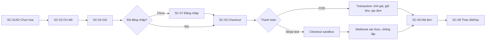
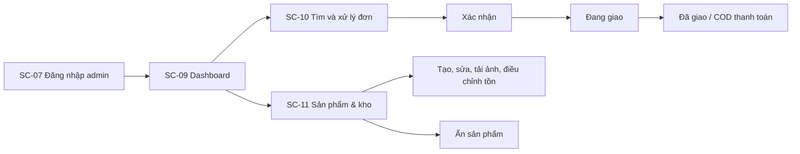

# Mộc Hoa · bản đồ use case và màn hình

Tài liệu theo dõi bản demo/CV tại `http://localhost:3001`. Ký hiệu: **Hoàn thành** = đã triển khai; **Đã thử** = đã kiểm tra trên localhost; **Chờ khóa** = cần credential của chủ dự án để kiểm thử dịch vụ ngoài.

## Use case

| Mã | Tác nhân | Điều kiện trước | Luồng chính | Lỗi / nhánh khác | Kết quả |
| --- | --- | --- | --- | --- | --- |
| UC-01 Xem hoa | Khách | PostgreSQL có sản phẩm đang bán | Mở trang chủ/danh mục; tìm theo tên, danh mục, dịp | Không có kết quả → thông báo và xóa lọc | Danh sách hoa phù hợp; **Hoàn thành, Đã thử** |
| UC-02 Xem chi tiết | Khách | Sản phẩm đang bán | Mở ảnh, mô tả, giá, tồn kho, sản phẩm gợi ý | Slug sai/đã ẩn → 404 | Thông tin sản phẩm; **Hoàn thành, Đã thử** |
| UC-03 Quản lý giỏ | Khách | Có sản phẩm còn hàng | Thêm, tăng/giảm số lượng, xóa; giỏ lưu trình duyệt | Hàng bị ẩn/hết kho → server từ chối khi đặt | Giỏ nhiều mặt hàng; **Hoàn thành, Đã thử** |
| UC-04 Tạo tài khoản | Khách | Email chưa đăng ký | Nhập tên, email, mật khẩu → lưu hash → đăng nhập | Email trùng hoặc dữ liệu sai → báo lỗi | Tài khoản khách; **Hoàn thành, Đã thử qua API** |
| UC-05 Đăng nhập | Khách/Admin | Có tài khoản | Email/mật khẩu hoặc Google → phiên Auth.js | Sai mật khẩu; Google thiếu khóa hoặc email trùng → báo lỗi | Phiên đúng vai trò; email demo **Đã thử**, Google **Chờ khóa** |
| UC-06 Đặt COD | Khách đăng nhập | Giỏ và địa chỉ hợp lệ | Server khóa sản phẩm, tính giá, giữ kho, tạo đơn + thanh toán chờ | Thiếu kho, dữ liệu sai → rollback | Đơn mới, mã đơn; **Hoàn thành, Đã thử** |
| UC-07 Thanh toán Stripe test | Khách đăng nhập | Có `sk_test_` và `whsec_` | Tạo Checkout; webhook xác nhận thanh toán; chuyển giữ kho thành bán | Checkout lỗi/hết hạn/thất bại → hủy, hoàn kho; event lặp → bỏ qua | Thanh toán test; mã và webhook **Hoàn thành**, luồng thật **Chờ khóa** |
| UC-08 Theo dõi/hủy đơn | Khách đăng nhập | Đơn thuộc tài khoản | Xem lịch sử, hủy COD chưa giao, hoàn kho | Đơn người khác/đã giao/Stripe → từ chối | Đơn cập nhật; **Hoàn thành, Đã thử** |
| UC-09 Xử lý đơn | Admin | Đăng nhập admin | Tìm/lọc đơn; xác nhận → đang giao → đã giao; COD ghi nhận đã thanh toán | Bước sai hoặc Stripe chưa thanh toán → từ chối | Trạng thái giao hàng và doanh thu cập nhật; **Hoàn thành, Đã thử** |
| UC-10 Quản lý hoa/kho | Admin | Đăng nhập admin | Tạo/sửa/ẩn sản phẩm, tải ảnh, chỉnh kho | Ảnh sai định dạng, SKU trùng, dữ liệu sai → từ chối | Catalog và tồn kho cập nhật; **Hoàn thành, Đã thử tạo/ẩn** |
| UC-11 Xem báo cáo | Admin | Có đơn mẫu | Lọc 7/30/90 ngày, xem doanh thu, đơn, hoa bán chạy, kho | DB lỗi → trang lỗi cài đặt | Dashboard; **Hoàn thành, Đã thử** |

## Màn hình

| Mã | URL | Truy cập | Thành phần / trạng thái chính | Tiến độ |
| --- | --- | --- | --- | --- |
| SC-01 Trang chủ | `/` | Mọi người | Hero, hoa nổi bật, dịp tặng, danh mục; dữ liệu động | Hoàn thành, Đã thử desktop/mobile |
| SC-02 Danh mục | `/products` | Mọi người | Tìm, lọc danh mục/dịp, lưới hoa, trạng thái rỗng | Hoàn thành, Đã thử |
| SC-03 Chi tiết | `/products/[slug]` | Mọi người | Ảnh, giá, kho, số lượng, thêm giỏ, 404 | Hoàn thành, Đã thử |
| SC-04 Giỏ hàng | `/cart` | Mọi người | Dòng hàng, sửa số lượng, tổng tiền, giỏ rỗng | Hoàn thành, Đã thử |
| SC-05 Checkout | `/checkout` | Đã đăng nhập | Địa chỉ, COD/Stripe, tổng, lỗi thiếu kho/thiếu khóa | Hoàn thành, Đã thử COD |
| SC-06 Kết quả | `/checkout/placed`, `/checkout/success`, `/checkout/cancel` | Mọi người | Mã đơn COD; chờ webhook Stripe; thanh toán hủy | COD Đã thử; Stripe Chờ khóa |
| SC-07 Đăng nhập/đăng ký | `/login`, `/register` | Khách chưa đăng nhập | Form, Google tùy chọn, thông tin tài khoản demo, lỗi | Email demo Đã thử; Google Chờ khóa |
| SC-08 Đơn của tôi | `/account/orders` | Khách/Admin | Lịch sử, trạng thái, hủy COD, trạng thái rỗng | Hoàn thành, Đã thử |
| SC-09 Dashboard | `/admin` | Admin | Doanh thu, biểu đồ, đơn mới, sản phẩm, form Stripe test | Hoàn thành, Đã thử |
| SC-10 Đơn quản trị | `/admin/orders` | Admin | Tìm/lọc/phân trang, cập nhật giao hàng | Hoàn thành, Đã thử |
| SC-11 Sản phẩm quản trị | `/admin/products` | Admin | Tạo/sửa/ẩn, tải ảnh, điều chỉnh kho | Hoàn thành, Đã thử tạo/ẩn |

## Liên kết use case → màn hình → tầng xử lý → dữ liệu

| Use case | Màn hình | API / service | Bảng PostgreSQL | Triển khai / kiểm thử |
| --- | --- | --- | --- | --- |
| UC-01–03 | SC-01–04 | Server Components → `catalog.repository`; `cart.ts` ở trình duyệt | `products`, `categories`, `flower_product_details`, `inventory_movements` | Xong; đã thử trình duyệt desktop/mobile |
| UC-04–05 | SC-07 | `/api/auth/register`, `/api/auth/[...nextauth]` → Auth.js và `user.repository` | `users` | Email xong, đã thử; Google chờ khóa |
| UC-06 | SC-05–06 | `POST /api/orders` → `order.service` → `order.repository` | `customers`, `orders`, `order_items`, `payments`, `inventory_movements` | Xong; đã thử đặt COD nhiều sản phẩm |
| UC-07 | SC-05–06 | `POST /api/checkout`, `POST /api/stripe/webhook` → `stripe.repository` | `orders`, `payments`, `stripe_events`, `inventory_movements` | Mã xong; webhook thử bằng chữ ký giả lập; thanh toán thật chờ khóa |
| UC-08 | SC-08 | `POST /api/orders/[id]/cancel` → `order.service` | `orders`, `payments`, `inventory_movements` | Xong; đã thử hủy và hoàn kho |
| UC-09,11 | SC-09–10 | `PATCH /api/admin/orders/[id]` → `order.service`; dashboard query | `orders`, `order_items`, `payments`, `inventory_movements` | Xong; đã thử giao COD và cập nhật doanh thu |
| UC-10 | SC-11 | `/api/admin/products`, `/api/admin/upload` → `product.service` → `admin-product.repository` | `products`, `flower_product_details`, `inventory_movements` | Xong; đã thử tạo và ẩn sản phẩm |

## Luồng mua hàng

## Luồng quản trị

## Việc cần cấu hình để thử dịch vụ ngoài

- Google OAuth: điền `AUTH_GOOGLE_ID` và `AUTH_GOOGLE_SECRET` theo [README](./README.md), rồi kiểm tra đăng nhập Google bằng tài khoản test của bạn.
- Stripe sandbox: điền `sk_test_` và `whsec_`, chạy Stripe CLI chuyển tiếp webhook, thử thẻ test. COD không phụ thuộc hai khóa này.
