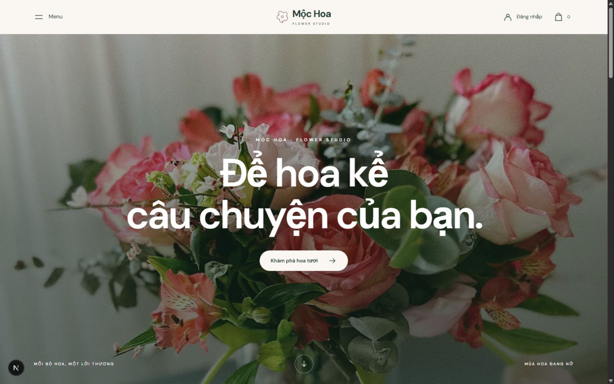

# Mộc Hoa

Dự án portfolio cá nhân của **nghiahnc**: website bán hàng tiếng Việt với **TypeScript, React, Next.js 16.4.1, PostgreSQL/Neon và Stripe sandbox**.

**[Mở demo](https://shop-hoa-nine.vercel.app)** · **[Mã nguồn](https://github.com/nghiahnc/shop-hoa)**



## Chức năng

- Danh mục hoa, tìm kiếm/lọc, chi tiết, giỏ và lịch sử đơn riêng của khách.
- Đăng ký, đăng nhập, phân quyền CUSTOMER/ADMIN; Google OAuth tùy chọn.
- COD, hủy trước giao và hoàn tồn; Stripe Checkout sandbox, webhook và idempotency.
- Quản trị sản phẩm, đơn và dashboard; upload ảnh JPG/PNG/WebP tối đa 5 MB qua private S3-compatible storage.
- Form demo điền sẵn; email/SKU mới để dễ trình diễn nhiều lần.

Giá, tài khoản và đơn là dữ liệu trình diễn. Thanh toán Stripe chỉ dùng sandbox; chưa tích hợp vận chuyển thật, thu tiền thật hoặc hoàn tiền tự động.

## Kiến trúc

**Layered Architecture**: `app/` và `components/` xử lý giao diện/HTTP; `services/` kiểm tra dữ liệu và điều phối nghiệp vụ; `repositories/` truy cập PostgreSQL; `db/` chứa migration/seed. Service tính lại giá, kiểm quyền và khóa tồn trước khi ghi đơn trong transaction. Stripe chỉ cập nhật thanh toán từ webhook đã xác thực, xử lý lặp an toàn.

Migration SQL có phiên bản trong `db/`; tiền VND được tính lại phía máy chủ. COD chỉ ghi đã thu khi hoàn tất giao hàng. Redirect từ Stripe không tự xác nhận đã trả tiền.

## Chạy từ bản clone mới

Yêu cầu **Node.js 24**, npm và một database PostgreSQL riêng (local hoặc Neon). `package-lock.json` được giữ để `npm ci` cài đúng dependency đã khóa.

```powershell
git clone https://github.com/nghiahnc/shop-hoa.git
cd shop-hoa
npm ci
Copy-Item .env.example .env.local
```

Tạo database trống `shop_hoa` bằng tài khoản PostgreSQL của bạn, rồi sửa `DATABASE_URL` trong `.env.local` theo role/mật khẩu/host thực tế. Với Neon dùng URL pooled cho ứng dụng, URL direct cho `DATABASE_URL_UNPOOLED`, kèm SSL. Không dùng lại database của website demo công khai.

Đặt `AUTH_SECRET` thành chuỗi ngẫu nhiên riêng, có thể tạo bằng `node -e "console.log(require('crypto').randomBytes(48).toString('base64url'))"`. Sau đó:

```powershell
npm run db:migrate
npm run db:seed
npm run db:seed-demo
npm run dev
```

Mở **http://localhost:3001**. Các lệnh seed chỉ dành cho database demo của bạn; `db:seed-demo` có thể đặt lại mật khẩu fixture. Build production: `npm run build`, sau đó `npm run start`.

## Tài khoản demo công khai

| Vai trò | Email | Mật khẩu mẫu |
| --- | --- | --- |
| Khách | `demo@mochoa.local` | `Demo1234!` |
| Quản trị demo | `admin@mochoa.local` | `Admin1234!` |

Các tài khoản này được công bố có chủ đích cho bản trình diễn và hiện tại `/login`; dùng thông tin giả khi thử. Không dùng mật khẩu fixture cho hệ thống thật.

## Stripe và dịch vụ tùy chọn

COD không cần khóa Stripe. Muốn thử thẻ, tự cấu hình `STRIPE_SECRET_KEY` loại **test** và `STRIPE_WEBHOOK_SECRET`; không đưa giá trị thật vào Git. Endpoint: `POST /api/stripe/webhook`, nhận Checkout completed/expired/async payment succeeded/failed.

```powershell
stripe listen --forward-to localhost:3001/api/stripe/webhook
```

Đặt signing secret CLI cung cấp vào `.env.local`, khởi động lại app. Webhook production phải có secret riêng. Bản demo dùng Customer sandbox và Visa **4242** đã lưu, hạn **12/34**; có thể xác nhận bằng nút Pay. Không dùng thẻ thật. Khi cần nhập thẻ test thủ công dùng 4242 4242 4242 4242, hạn tương lai và CVC bất kỳ ba chữ số. Nếu Stripe không nhận VND, `DEMO_VND_PER_USD=26000` chỉ là tỷ giá minh họa.

Google OAuth chỉ bật khi có `AUTH_GOOGLE_ID` và `AUTH_GOOGLE_SECRET`; callback local là `http://localhost:3001/api/auth/callback/google`. Upload tùy chọn dùng `UPLOAD_S3_ENDPOINT`, `UPLOAD_S3_ACCESS_KEY_ID`, `UPLOAD_S3_SECRET_ACCESS_KEY`, `UPLOAD_S3_REGION`, `UPLOAD_BUCKET`. Bucket private cần CORS cho origin của bản clone; script `scripts/configure-upload-cors.mjs` dùng để cấu hình bucket của bạn. Ảnh tĩnh có sẵn không cần dịch vụ upload. 

## Kiểm tra

```powershell
npx tsc --noEmit
npm run build
# Trên database kiểm thử riêng đã migrate/seed:
npm run db:verify
# Mở app ở terminal khác trước khi chạy kiểm thử HTTP:
node tests/storefront-auth.mjs
```

Các script nghiệp vụ có thể tạo/xóa fixture; luôn kiểm tra đang trỏ tới database thử của bạn. Báo cáo trước lần công bố GitHub: [QA Vercel](artifacts/vercel/QA.md), [QA giao diện](artifacts/homepage/QA.md). Log thô và phiên thanh toán được giữ ngoài Git.

## Triển khai và tài liệu

Vercel chạy Next.js Node.js; Neon chỉ cung cấp database/dịch vụ backend. Tạo project của bạn và đặt biến môi trường qua dashboard hoặc CLI. `npm run secrets:vercel` đọc file riêng `.env.vercel.local`; chỉ dùng khi đã link đúng project. Repo không chứa liên kết `.vercel/` của website đang chạy.

- [Nguồn ảnh và tài nguyên](ASSET_SOURCES.md)
- [Use case và sơ đồ chức năng](PROJECT_MAP.md)
- [Ảnh mobile](artifacts/homepage/mobile.jpg)

Giữ nguyên ghi công và giấy phép của ảnh, font, thư viện khi sử dụng lại.
